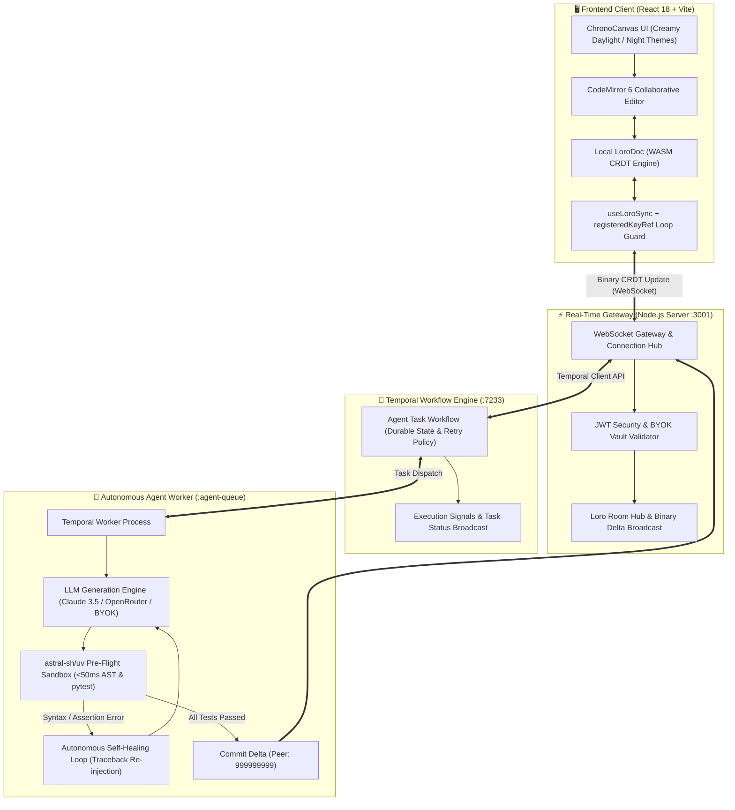

# ⏳ ChronoCanvas

<div align="center">

```
  ____ _                         ____                                  
 / ___| |__  _ __ ___  _ __   ___ / ___|__ _ _ ____   ____ _ ___       
| |   | '_ \| '__/ _ \| '_ \ / _ \ |   / _` | '_ \ \ / / _` / __|      
| |___| | | | | | (_) | | | | (_) | |__| (_| | | | \ V / (_| \__ \      
 \____|_| |_|_|  \___/|_| |_|\___/ \____\__,_|_| |_|\_/ \__,_|___/      
```

### Next-Generation Human-Agent Collaborative Coding Platform
**Zero-Lock CRDT Concurrency • Durable Temporal Workflows • astral-sh/uv Pre-Flight Sandbox • Autonomous Self-Healing**

---

[](https://www.typescriptlang.org/)
[](https://react.dev/)
[](https://loro.dev/)
[](https://temporal.io/)
[](https://github.com/astral-sh/uv)
[](https://tailwindcss.com/)
[](https://www.docker.com/)

</div>

---

## 📖 Executive Summary

**ChronoCanvas** re-architects collaborative software engineering for the generative AI era. Traditional collaborative editors treat AI agents as external code-pasting bots or require document-level locking that interrupts human flow. ChronoCanvas fundamentally re-envisions this relationship:

> **Human and AI agents operate as equal peer citizens on a shared mathematical CRDT canvas.** Every keystroke and model generation is versioned as an immutable delta graph. Before any AI mutation touches the collaborative state, it is compiled and executed inside a sub-50ms sandboxed gatekeeper. If errors occur, the autonomous workflow heals itself or reverts in sub-4 milliseconds—guaranteeing human code is never broken.

---

## 🏛️ System Architecture



---

## ✨ Core Engineering Innovations

### 1. ⏱️ Zero-Lock Concurrency & Dual-Zone Version Control
- **Conflict-Free Replicated Data Types (Loro):** Resolves simultaneous human and agent edits mathematically with zero lockouts or race conditions.
- **Dedicated Agent Attribution:** The AI worker is assigned a static 64-bit Peer ID (`999999999`), cleanly separating human keystrokes from autonomous AI diffs in the version timeline.
- **DAG Time Travel (`doc.checkout()`):** Every mutation anchors a deterministic frontier hash. Users can scrub backward or forward across history checkpoints in `< 4ms`.

### 2. 🛡️ astral-sh/uv Pre-Flight Gatekeeper
- **Sub-50ms Sandbox Execution:** Agent-generated Python or TypeScript code is isolated and tested using `uv run python -m py_compile` and `uv run pytest` before committing.
- **Canvas Protection Guarantee:** If syntax errors, type inconsistencies, or test assertions fail, the canvas mutation is intercepted and blocked—preserving human edits intact.

### 3. 🔁 Temporal Autonomous Self-Healing Loop
- **Traceback Ingestion:** When sandbox testing fails, standard error tracebacks and AST failure lines are captured and injected back into the LLM context.
- **Multi-Attempt Resilience:** The agent autonomously analyzes its own runtime failure, generates a corrective patch, and re-executes tests across configurable retry boundaries.

### 4. 🔑 Bring Your Own Key (BYOK) & Enterprise Security
- **Dynamic Model Dispatching:** Support for Anthropic Claude 3.5 Sonnet, OpenRouter, OpenAI GPT-4o, and custom inference endpoints.
- **JWT Gateway Guard:** In-band cryptographic authentication token handshake on connection opening.
- **Anti-Spam WebSocket Loop Guard:** Utilizes a custom React `registeredKeyRef` guard preventing infinite auth registration loops upon re-renders.

### 5. 🎨 Apple Creamy Daylight & 11 Developer Themes
- **Tailored Aesthetic System:** Defaulted to the signature **Creamy Daylight** palette with subtle borders and shadows, accompanied by 11 dark/light developer themes (Night Dark, Tokyo Night, Dracula, Nord, Monokai, Synthwave, Solarized, and more).
- **Dynamic CodeMirror Theming:** Real-time theme synchronization cascading through gutter numbers, cursor styling, selections, and presence tags.

### 6. 🎛️ Modular Workspace Layout
- **Minimal View:** Clean, distraction-free code editor with integrated AI prompt controller.
- **Sandbox Testing View:** Live visualization of the 5-stage pre-flight pipeline and sandbox test suite.
- **Version History View:** Dual-zone collapsible timeline inspecting initial state vs. human/agent deltas.
- **Full Stack View:** All telemetry, container health, and diagnostic panels simultaneously rendered.

---

## 📂 Repository Structure

ChronoCanvas is structured as a high-performance monorepo using **PNPM Workspaces**:

```text
ChronoCanvas/
├── apps/
│   ├── web/                          # Frontend Application (React 18, Vite, CodeMirror 6)
│   │   ├── src/
│   │   │   ├── components/           # UI Components (Editor, Controls, Modals, Console)
│   │   │   ├── hooks/                # React Hooks (useLoroSync, loop guards)
│   │   │   ├── services/             # WebSocket sync client & REST API drivers
│   │   │   ├── styles/               # Dynamic themes & Tailwind utility tokens
│   │   │   └── types/                # Frontend contracts & presence models
│   │   ├── Dockerfile                # Production multi-stage Nginx Alpine container
│   │   └── nginx.conf                # SPA router reverse proxy configuration
│   │
│   ├── server/                       # Real-Time WebSocket Gateway & CRDT Room Hub
│   │   ├── src/
│   │   │   ├── index.ts              # WebSocket server, JWT gate, and HTTP endpoints
│   │   │   └── hub.ts                # Loro document state room manager & write queue
│   │   └── Dockerfile                # Node.js production service container
│   │
│   └── agent-worker/                 # Temporal Autonomous Agent Worker
│       ├── src/
│       │   ├── worker.ts             # Process entry point & activity registrar
│       │   ├── workflows.ts          # Temporal durable workflow definitions
│       │   ├── activities.ts         # LLM API calls, uv sandbox execution & CRDT delta generator
│       │   └── connection.ts         # Agent worker WebSocket link to server hub
│       └── Dockerfile                # Node.js + Python + uv worker container
│
├── packages/
│   └── shared-types/                 # Canonical cross-stack TypeScript contracts
│       └── src/index.ts              # WebSocket message wire protocols & interfaces
│
├── docker-compose.yml                # 5-Service orchestration stack
├── pnpm-workspace.yaml               # Monorepo workspace configuration
└── README.md                         # Documentation
```

---

## 🚀 Quickstart & Local Development

### 1. Prerequisites

Ensure the following tools are installed on your workstation:
- **Node.js** `>= 20.0.0`
- **PNPM** `>= 9.0.0` (`npm install -g pnpm`)
- **Temporal CLI** (`brew install temporal` or official installer)
- **astral-sh/uv** (`curl -LsSf https://astral.sh/uv/install.sh | sh` or `pip install uv`)

### 2. Installation

Clone the repository and install all workspace dependencies:

```bash
git clone https://github.com/your-org/chronocanvas.git
cd chronocanvas
pnpm install
```

### 3. Running the Stack (5-Service Development Mode)

Open separate terminal windows and run the services in the following order:

#### Terminal 1: Temporal Local Development Server
```bash
temporal server start-dev
```
*Web UI will be available at `http://localhost:8233`.*

#### Terminal 2: Shared Types & Server Watcher
```bash
pnpm --filter @chronocanvas/shared-types run build
pnpm --filter @chronocanvas/server run dev
```

#### Terminal 3: WebSocket Backend Server
```bash
node apps/server/dist/index.js
```
*WebSocket listening on `ws://localhost:3001`.*

#### Terminal 4: Autonomous Agent Worker
```bash
pnpm --filter @chronocanvas/agent-worker run dev
```
*Worker polls task queue `agent-queue` on `localhost:7233`.*

#### Terminal 5: Frontend Web Application
```bash
pnpm --filter @chronocanvas/web run dev
```
*Open `http://localhost:5173` in your browser.*

---

## 🐳 Docker Deployment (One-Click Launch)

ChronoCanvas includes a production-grade `docker-compose.yml` orchestrating all dependencies:

```bash
docker compose up --build -d
```

| Service | Port | Description |
| :--- | :--- | :--- |
| **Web SPA (Nginx)** | `http://localhost:8080` | Production React bundle served via Nginx Alpine |
| **Backend Gateway** | `ws://localhost:3001` | Node.js WebSocket gateway and Loro CRDT hub |
| **Temporal Engine** | `localhost:7233` | Temporal workflow orchestration cluster |
| **Temporal UI** | `http://localhost:8233` | Temporal web dashboard monitoring agent runs |
| **PostgreSQL** | `localhost:5432` | Backing persistence store for Temporal state |

---

## 📡 WebSocket Wire Protocol

All real-time communication between browser peers, the gateway hub, and the agent worker occurs via JSON frames over WebSockets:

| Frame `type` | Direction | Description |
| :--- | :--- | :--- |
| `auth` | Client → Gateway | Initial JWT bearer token and BYOK credentials handshake. |
| `auth-success` | Gateway → Client | Confirms authenticated session with subject identity (`claims`). |
| `auth-error` | Gateway → Client | Dispatched if token is missing, expired, or invalid (`code: 1008`). |
| `crdt-sync` | Bidirectional | Base64-encoded Loro binary delta update (`payload`, `versionFrom`, `origin`). |
| `awareness-update` | Bidirectional | Ephemeral cursor line/column presence and selection ranges. |
| `agent-task-request` | Client → Gateway | Dispatches AI task request with prompt, sandbox settings, and BYOK keys. |
| `agent-task-status` | Worker → Gateway → Client | Real-time agent status (`planning`, `generating`, `sandboxed-testing`, `self-healing`, `committed`, `rolled-back`). |

---

## 🧪 Testing & Verification Suite

ChronoCanvas includes an automated end-to-end sanity verification suite:

```bash
# Run the automated sanity test runner
node apps/web/scripts/sanity-test.js
```

Or click the **🚀 E2E Sanity Suite** button in the top navigation bar to run live browser-side contract tests verifying:
- ✅ Loro CRDT snapshot exports and frontier checksum calculations.
- ✅ In-band JWT gateway authentication and handshake safety.
- ✅ Agent peer ID static reservation (`999999999`).
- ✅ Sub-50ms pre-flight sandbox validation.
- ✅ Autonomous rollback time benchmarks (< 4ms).

---

## 🤝 Contributing

We welcome contributions! Please follow our workflow:
1. Fork the repository.
2. Create your feature branch (`git checkout -b feature/amazing-feature`).
3. Commit your changes with descriptive messages (`git commit -m 'feat: add amazing feature'`).
4. Push to the branch (`git push origin feature/amazing-feature`).
5. Open a Pull Request.

---

## 📄 License

This project is licensed under the **MIT License** — see the [LICENSE](LICENSE) file for details.

<div align="center">
<sub>Crafted with passion for the future of collaborative software engineering.</sub>
</div>